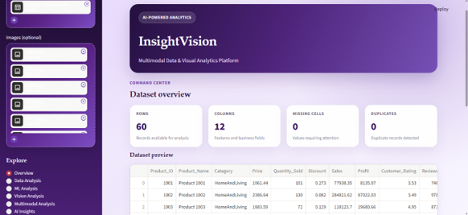
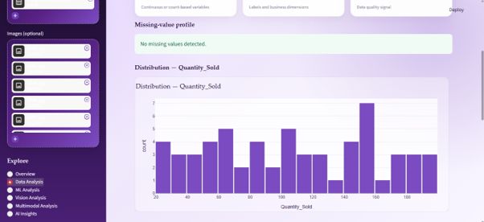
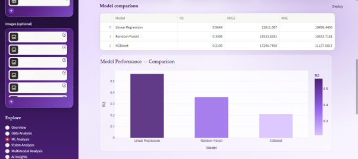
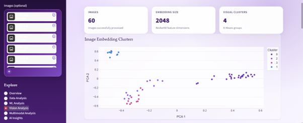
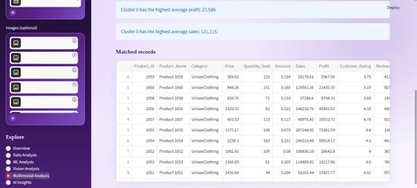
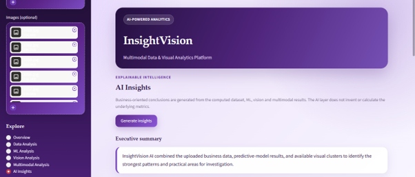

# InsightVision 

### Multimodal Data & Visual Analytics Platform

InsightVision is an interactive analytics platform that combines **Data Analysis, Machine Learning, Computer Vision, Image Clustering, Multimodal Analysis, and AI-generated Business Insights** into a single Streamlit application.

The platform allows users to upload a business dataset along with corresponding product images and analyze both structured business information and visual product characteristics.

---

## Overview

Traditional business analytics mainly focuses on structured tabular data such as sales, profit, quantity, discount, ratings, and inventory.

InsightVision extends this analysis by incorporating product images into the analytical workflow.

The system extracts visual features from product images using a pretrained **ResNet50** model, generates image embeddings, groups visually similar products using **K-Means clustering**, and combines these visual groups with business metrics.

This enables users to investigate relationships between **product appearance and business performance**.

---

## Key Features

### 1. Data Analysis

- CSV and Excel dataset upload
- Automatic data profiling
- Missing-value analysis
- Duplicate detection
- Numerical and categorical column identification
- Exploratory Data Analysis
- Distribution analysis
- Correlation heatmaps
- Category-wise business analysis
- Business KPI analysis

### 2. Machine Learning

- Automatic classification/regression task inference
- Regression models
- Classification models
- Random Forest
- Linear/Logistic Regression
- XGBoost
- Model comparison
- Performance evaluation
- Feature importance analysis
- Leakage-aware preprocessing

### 3. Computer Vision

- Product image upload
- Image preprocessing
- Pretrained ResNet50 feature extraction
- 2048-dimensional image embeddings
- Visual feature representation

### 4. Image Clustering

- K-Means clustering
- PCA dimensionality reduction
- 2D visual representation of image embeddings
- Visual grouping of similar products

### 5. Image Similarity

The platform uses image embeddings and cosine similarity to identify visually similar product images.

### 6. Multimodal Analysis

The system connects:

**Business Data + Product Images**

Product images are matched with their corresponding `Product_ID` values.

The system can then compare business metrics across visual product clusters.

Examples of analyzed metrics include:

- Sales
- Profit
- Quantity Sold
- Price
- Discount
- Customer Rating
- Reviews
- Stock Available

### 7. AI Insights

The AI Insights module converts analytical results into natural-language explanations and recommendations.

The platform includes a deterministic local insight generation mechanism and supports optional Gemini API enhancement.

### 8. Interactive Streamlit Dashboard

The entire system is integrated into an interactive Streamlit dashboard containing:

- Overview
- Data Analysis
- ML Analysis
- Vision Analysis
- Multimodal Analysis
- AI Insights

---

# System Architecture

```text
                         USER
                           |
                           v
              Upload Dataset + Product Images
                           |
                +----------+----------+
                |                     |
                v                     v
        DATA ANALYSIS          COMPUTER VISION
        (Business Data)        (Product Images)
                |                     |
                v                     v
        Data Preprocessing     Image Processing
                |                     |
                v                     v
        Exploratory Data          ResNet50
           Analysis                 |
                |                   v
                v             Image Embeddings
        Business KPIs              |
                |                   v
                v             Clustering / PCA
        MACHINE LEARNING            |
                |                   |
                +---------+---------+
                          |
                          v
                 MULTIMODAL ANALYSIS
                          |
                          v
                     AI INSIGHTS
                          |
                          v
                STREAMLIT DASHBOARD


## Dashboard Preview

### Dashboard


### Overview


### Data Analysis


### Machine Learning Analysis


### Computer Vision Analysis


### Multimodal Analysis


### AI Insights
